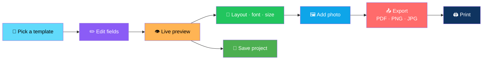
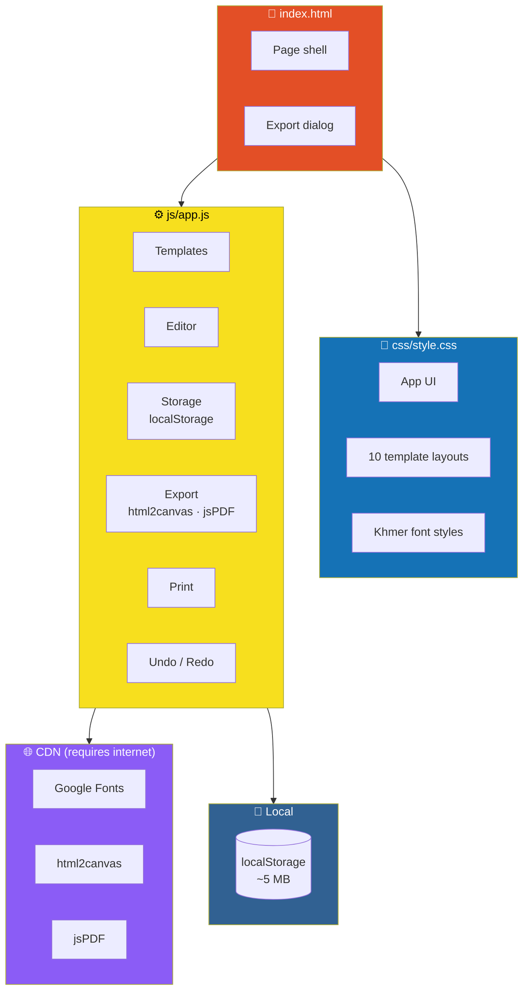

# 📰 Vintage Newspaper Maker

<div align="center">


**Create vintage-style newspaper pages in the browser.**

*10 templates · Live preview · PDF / PNG / JPG export · Printing · Local project saving*

[🚀 Run It](#-run-it-windows-vs-code) • [✨ How to Use](#-how-to-use) • [🇰🇭 Khmer Fonts](#-khmer-fonts) • [🏗️ Architecture](#️-architecture) • [💾 Saving & Backups](#-saving--backups)

</div>

---

## 📖 Overview

**Vintage Newspaper Maker** lets you create **vintage-style newspaper pages** right in the browser.

### Core Idea

> **No backend. No login. Everything runs locally.**
>
> Pick a template, edit fields, watch the page update live, then export to PDF, PNG, or JPG — or print it.

### The Workflow



---

## 🚀 Run It (Windows, VS Code)

### 1. Open the Project

Unzip the folder and open it in VS Code — **File → Open Folder**.

### 2. Install Live Server

Install the **Live Server** extension *(by Ritwick Dey)* if you don't have it.

### 3. Launch

**Right-click `index.html` → Open with Live Server.**

> ⚠️ **An internet connection is needed.**
>
> Google Fonts and the export libraries *(html2canvas, jsPDF)* load from CDNs.

---

## 📁 Folder Structure

```
vintage-newspaper-maker/
├── index.html      page structure + export dialog
├── css/style.css   app UI, 10 template layouts, Khmer font styles
├── js/app.js       templates, editor, storage, export, print
└── README.md
```

---

## ✨ How to Use

### 1. 🏠 Home

Click a **template card**.

### 2. ✏️ Editor

- **Edit fields on the left** — the newspaper updates **live**
- Use the **Layout box** to change:
  - Template
  - Font style
  - Page size — **A4 / A3 / Letter**
  - Orientation

### 3. 🖼️ Photo

- Upload **JPG / PNG / WebP / GIF** *(max **15 MB**)*
- Choose a filter first:
  - **Black & white**
  - **Sepia**
  - **Original**

### 4. 🛠️ Toolbar

| Action | Shortcut |
|--------|:--------:|
| **Save** | `Ctrl+S` |
| **Undo** | — |
| **Redo** | — |
| **Download** | — |
| **Print** | — |

### 5. 📤 Download

1. Enter a **file name**
2. Pick a format — **PDF / PNG / JPG**
3. Choose a **resolution** *(and JPG quality for JPG)*

### 6. 📂 My Projects

- **Open**
- **Rename**
- **Duplicate**
- **Delete**
- **Export** — as `.json`
- **Import** projects

---

## 🇰🇭 Khmer Fonts

In **Layout → Font style**, choose a Khmer style — or press **"Fill with Khmer sample text"**.

<div align="center">

| Style | Headings | Body |
|-------|----------|------|
| **Khmer Vintage** | Moul | Hanuman |
| **Khmer Classic** | Bokor | Battambang |
| **Khmer Bold** | Koulen | Noto Serif Khmer |
| **Khmer Formal** | Moulpali | Hanuman |

</div>

### What Khmer Styles Change

- **Replace the template's fonts**
- **The date and price line switch to Khmer**
- **Text is left-aligned with taller line spacing** — since Khmer has no spaces between words

### ➕ Add Your Own Font

**Three steps:**

1. Add its **Google Fonts name** to the `<link>` in `index.html`
2. Add an `.paper.fk-kmN{--kh:'Heading font';--kb:'Body font'}` rule in `css/style.css`
3. Add an `<option value="kmN">` in `js/app.js`

---

## 🏗️ Architecture

### System Overview



### Design Principles

<div align="center">

| Principle | Implementation |
|-----------|---------------|
| **📄 No build step** | Plain HTML + CSS + JavaScript — open it and it works |
| **🖥️ No backend, no login** | Everything runs in the browser; nothing is sent anywhere |
| **👁️ Live preview** | The newspaper updates as you edit fields — no separate preview button |
| **🎨 10 templates** | Each is a distinct layout — swap with one dropdown |
| **🇰🇭 Khmer-aware** | Four font styles, Khmer date/price lines, and left-aligned spacing tuned for Khmer text |
| **📤 Real exports** | PDF, PNG, and JPG — via `html2canvas` and `jsPDF` |
| **💾 Local projects** | Stored in `localStorage` — export/import as `.json` for backups |
| **🖨️ Print-friendly** | Uses the browser dialog with a note about background graphics |
| **↩️ Undo / Redo** | Every edit is reversible |
| **🚫 No telemetry** | No analytics, no tracking, no server |

</div>

---

## 💾 Saving & Backups

### Where Projects Live

> **Projects live in your browser's `localStorage` — about 5 MB.**

### ⚠️ Important Warnings

- **Lost if you clear browser data**
- **Not shared between browsers**
- **Not shared between PCs**
- **Photos use the most space**

### ✅ Back Up Every Project

**Use Export** on **My Projects** to back up each project as a file.

**Use Import** to restore it.

---

## 📤 Export Notes

<div align="center">

| Format | Notes |
|--------|-------|
| **PDF** | One page at the chosen size — very long content is **scaled to fit** |
| **PNG / JPG** | Use **2× or 3× resolution** for sharper images — very large pages at **3× may fail in some browsers** |
| **Print** | Uses the browser dialog — **enable "Background graphics" for full paper colour** |

</div>

---

## 🔧 Troubleshooting

<div align="center">

| Problem | Solution |
|---------|---------|
| **Export does nothing / error** | Check your internet connection and reload |
| **Fonts look plain** | Fonts didn't load — reload while online |
| **"Browser storage is full"** | Export projects, delete some, or use smaller photos |

</div>

---

## 🗺️ Roadmap

### ✅ Current

- [x] 10 vintage newspaper templates
- [x] Live preview as you edit
- [x] Layout controls — template, font style, page size, orientation
- [x] Page sizes — A4, A3, Letter
- [x] Photo upload with B&W, sepia, or original filter
- [x] 15 MB photo size limit
- [x] Save with `Ctrl+S`
- [x] Undo and Redo
- [x] Export to PDF, PNG, and JPG
- [x] Configurable resolution and JPG quality
- [x] Print with browser dialog support
- [x] Local project storage in `localStorage`
- [x] Open, rename, duplicate, and delete projects
- [x] Export and import projects as `.json`
- [x] Four Khmer font styles with tuned line spacing
- [x] Khmer sample text fill
- [x] Khmer date and price line switching
- [x] Add-your-own-font path documented

### 🔜 Future Ideas

- [ ] **More templates** beyond the current 10
- [ ] **Custom template builder** — drag-and-drop layout editor
- [ ] **Additional Khmer font styles**
- [ ] **Multi-page documents** in a single project
- [ ] **Text alignment and column controls** in the editor
- [ ] **IndexedDB storage** — for larger projects beyond the ~5 MB `localStorage` limit
- [ ] **Offline mode** — bundle fonts and libraries locally
- [ ] **SVG export** — for infinite-resolution printing
- [ ] **Cloud sync** *(opt-in)* — for sharing across devices
- [ ] **Localization** — bilingual UI

---

## 🤝 Contributing

Contributions are welcome. Please:

1. Fork the repository
2. **Keep it build-free** — no bundlers, no frameworks
3. **Keep it backend-free** — no server, no accounts, no telemetry
4. **Add new Khmer fonts** by following the three-step path documented above
5. **Preserve the live preview** — every field must update without a save button
6. **Preserve the export quality options** — resolution and JPG quality matter
7. Test on Chrome, Firefox, Safari, and Edge
8. Submit a Pull Request

### Guidelines

- **Never add a required backend** — the app must work from a static host
- **Never break project compatibility** — `.json` exports must remain importable
- **Never remove Khmer support** — it's a first-class feature, not an afterthought
- **Never assume `localStorage` has room** — handle the full-storage case gracefully
- **Never present a stub as a feature**

---

## 📜 License

MIT — see [LICENSE](LICENSE) for details.

---

## 🙏 Acknowledgments

- **Google Fonts** — for the historical and Khmer typography this app depends on
- **html2canvas** — for making DOM-to-image export possible
- **jsPDF** — for real PDF output in the browser
- **Every designer who's ever wanted a vintage newspaper layout without opening InDesign** — this one's for you

---

<div align="center">

### 📰 PICK. EDIT. EXPORT. PRINT.

**Create vintage-style newspaper pages in the browser.**

**10 templates. Live preview. Khmer fonts. No backend.**

<br>

⭐ If this tool helped you, consider giving it a star.

<br>

[⬆ Back to Top](#-vintage-newspaper-maker)

</div>
